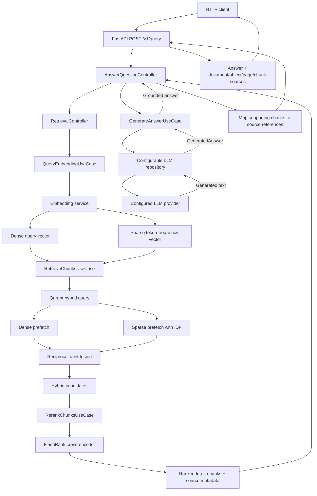
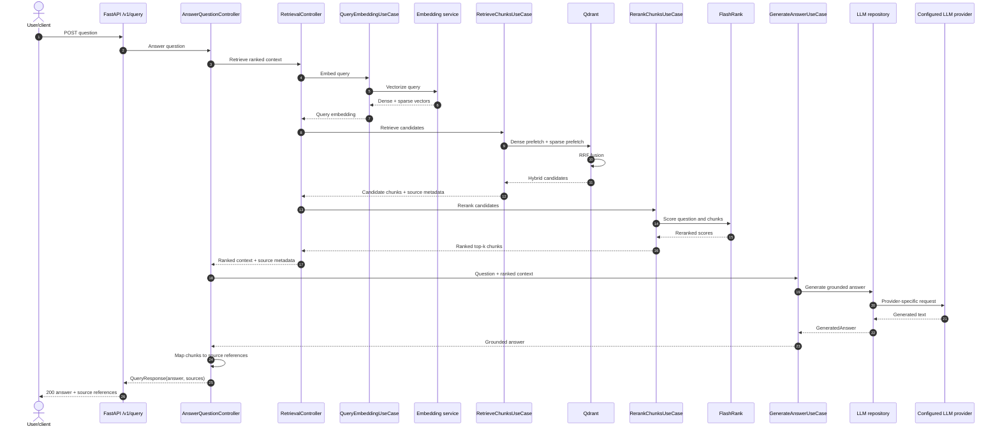

# Enterprise RAG — Query

`enterprise-rag-query` is the retrieval and question-answering component of the Enterprise RAG prototype. It exposes a Python **FastAPI** service (served with **Granian**) that embeds a user question, retrieves relevant document chunks from Qdrant, asks an LLM to answer using the retrieved context, and returns the answer **together with source references**.

Its detailed internal design is **to be defined later**, as stated in the project's root [`AGENTS.md`](https://github.com/tolga-kabadurmus/enterprise-rag/blob/main/AGENTS.md). The URL assumes that repository is created under the indicated GitHub account. This README only establishes its minimum functional contract and conceptual boundaries.

Authentication (authn) and authorization (authz) are outside the scope of this project and are not implemented or covered by this service.

## Responsibilities

- Accept a user question through an HTTP API.
- Generate a query embedding compatible with the indexing component's embedding model and vector dimensions.
- Retrieve relevant chunks with dense and sparse Qdrant searches fused by RRF.
- Rerank the fused candidate set locally with FlashRank before returning top-k.
- Construct an LLM request using the question and retrieved context.
- Return the answer and references to the retrieved sources.
- Handle invalid requests, unavailable providers, empty retrieval results, and operational errors with logging and appropriate API responses.

## Target relationship flow

The `/v1/retrieval` endpoint completes embedding, hybrid retrieval, and
reranking and returns the top chunks. The `/v1/query` and `/v1/query/stream`
endpoints continue through answer generation and response-scoped citation
mapping.



## Target question-answering sequence

The sequence below extends the implemented retrieval stages with the planned
LLM coordination needed for the minimum end-to-end RAG response.



## Minimum response contract

`POST /v1/query` returns the complete generated answer and response-scoped citation labels with document identifier, source object key, and page/chunk information where available. `POST /v1/query/stream` emits answer `delta` events followed by one `sources` event and one `done` event.

Both endpoints call the configured LLM with provider streaming enabled. The
non-streaming HTTP endpoint buffers all provider deltas before returning its
single JSON response.

Answers should be grounded in retrieved context. If no usable source material is retrieved, the service should respond transparently rather than invent document citations. The indexing service remains responsible for producing the metadata needed for citations.

## Architectural conventions

- Implement in Python, using FastAPI for REST endpoints and Granian as the ASGI server.
- Follow Clean Architecture: repositories encapsulate Qdrant, embeddings, and LLM provider access; use cases hold application logic; controllers coordinate multiple use cases where required.
- Instantiate provider-specific adapters through `RepositoryFactory` and inject them into use cases via constructors.
- Each API endpoint should delegate to one use case or one controller, with centralized configuration, validation, logging, and error handling.
- Keep the LLM provider and model configurable. Complete responses use JSON and streamed responses use Server-Sent Events (SSE).
- Keep the first working implementation simple before introducing optional features.

## Configuration

Configuration is provided through environment variables with a safe template in the root `dev-envs/` directory. Hybrid retrieval uses `QDRANT_DENSE_VECTOR_NAME`, `QDRANT_SPARSE_VECTOR_NAME`, `RAG_CANDIDATE_K`, `RAG_TOP_K`, and `RAG_HYBRID_PREFETCH_LIMIT`. Reranking uses the `RERANKING_` settings group. The embedding dense model, sparse model, and vector names must match indexing.

The default FlashRank TinyBERT model is intentionally the smallest CPU option
and is best suited to English. Use a supported multilingual model when the
indexed corpus requires multilingual reranking.

## OpenAPI documentation

The running service publishes its complete generated API contract at these
local Compose URLs:

- Swagger UI: <http://localhost:8000/docs>
- ReDoc: <http://localhost:8000/redoc>
- OpenAPI JSON: <http://localhost:8000/openapi.json>

The contract describes `/v1/query`, `/v1/query/stream`, `/v1/retrieval`, and
the diagnostic `/v1/embeddings` endpoint, including schemas, examples,
dependency error statuses, field descriptions, tags, and stable operation IDs. See
[OpenAPI and interactive API documentation](docs/openapi.md).

## Running with Docker Compose

This repository is a Git submodule of [`enterprise-rag`](https://github.com/tolga-kabadurmus/enterprise-rag), which owns `docker-compose.yaml`. From the parent repository root, the intended startup command is:

```bash
docker compose up -d --build minio qdrant enterprise-rag-query
docker compose logs -f enterprise-rag-query
```

**Planned commands, not yet verified:** These assume the corresponding services are defined in the parent Compose file. The actual API URL, route and exposed port will be documented after the FastAPI application is implemented. The query service depends on content having already been indexed by `enterprise-rag-indexing`.

Stop the stack from the parent repository root:

```bash
docker compose down
```

## Local development

```bash
python3 -m virtualenv .venv
source .venv/bin/activate
pip install -r requirements.txt
```

This component keeps its own `requirements.txt`, tests, and Dockerfile under `Dockerfiles/`. Use host-side virtual environments for local Python development and Compose for stack integration.

## Testing and documentation

Use unit tests for use cases, controllers, source-reference mapping, and request validation, with fake/mock repositories. Use integration tests for Qdrant and the configured embedding/LLM provider as appropriate, plus an end-to-end check against documents indexed by the indexing component. Do not leak secrets, sensitive document contents, or detailed internal errors in API responses or logs. MkDocs is the selected documentation framework.

The maintained developer documentation starts at [`docs/index.md`](docs/index.md).

## Future enhancements

Potential additions include conversation memory, prompt templates, multi-agent workflows, evaluation pipelines, CI/CD, Kubernetes/OpenShift Helm charts, and an observability dashboard. These are **optional** and should not be represented as already implemented.

This README is **conceptual documentation** for an application that has not yet been fully designed or implemented. Keep it synchronized with the actual routes, schemas, dependencies, and container behavior as development proceeds.
