# Architecture

The service will follow the project Clean Architecture conventions:

- REST API handlers validate transport input.
- Controllers coordinate multi-step RAG operations.
- Use cases contain application behavior and depend on one primary repository.
- Capability-specific repositories isolate embedding, vector-store, and LLM I/O.
- `app/main.py` is the composition and ASGI entry point.

The query-embedding slice is implemented: `QueryEmbeddingUseCase` depends on
the embedding repository contract, and the HTTPX adapter calls the shared
embedding service with explicit `query` intent. It validates and returns aligned
dense and sparse representations. The registry-based factory
selects the validated provider enum. FastAPI lifespan creates one pooled HTTPX
client, injects the repository into the use case through `app.state`, and
closes it during shutdown. A temporary `POST /v1/embeddings` endpoint exposes
this one step for development verification. `RetrievalController` now
coordinates that use case with `RetrieveChunksUseCase`, and
`POST /v1/retrieval` exposes the question-to-context slice. The final LLM-backed
RAG query endpoint and health endpoints remain unimplemented.

`UnhandledExceptionMiddleware` converts embedding, vector retrieval, reranking, and LLM
provider failures into sanitized `429`, `502`, `503`, or `504` responses.
Invalid application input uses `422`; unexpected failures are logged and
returned as a generic `503` rather than exposing an HTTP 500 response.

```mermaid
flowchart LR
    Request[POST /v1/retrieval] --> Controller[RetrievalController]
    Controller --> EmbedUC[QueryEmbeddingUseCase]
    EmbedUC --> EmbeddingAPI[Embedding service]
    EmbeddingAPI --> Dense[Dense vector]
    EmbeddingAPI --> Sparse[Sparse vector]
    Controller --> RetrieveUC[RetrieveChunksUseCase]
    Dense --> RetrieveUC
    Sparse --> RetrieveUC
    RetrieveUC --> VectorRepo[VectorRepositoryBase]
    VectorRepo --> DenseSearch[Qdrant dense prefetch]
    VectorRepo --> SparseSearch[Qdrant sparse prefetch]
    DenseSearch --> RRF[RRF fusion]
    SparseSearch --> RRF
    RRF --> Candidates[Hybrid candidates]
    Candidates --> RerankUC[RerankChunksUseCase]
    RerankUC --> FlashRank[FlashRank repository]
    FlashRank --> Results[Top-k chunks with citations]
```

The vector repository follows the same lifecycle: startup creates one
`AsyncQdrantClient`, selects `QdrantVectorRepository` through its capability
factory, and stores both on `app.state`. `RetrieveChunksUseCase` wraps the
provider-neutral repository, applies configured prefetch, candidate, and optional
score-threshold values, and maps indexed payloads into validated domain chunks
and citations. Qdrant performs both named-vector prefetches and reciprocal rank
fusion in one query.

`RerankChunksUseCase` sends the fused candidates through the provider-neutral
reranking repository, replaces their RRF scores with FlashRank relevance scores,
and returns the configured top-k. FastAPI startup loads one shared
`ms-marco-TinyBERT-L-2-v2` ranker. Inference is blocking CPU work, so the adapter
runs it with `asyncio.to_thread()` behind a bounded semaphore. Model loading
fails startup if the artifact cannot be downloaded or loaded. The default cache
is ephemeral and may download the approximately 4 MB model after a fresh start.

Strict immutable domain models now define the user question, retrieved chunks,
source references, generated answers, and future REST request/response shapes.
They do not yet introduce an endpoint or orchestration behavior.

The LLM capability provides a provider-neutral base contract, registry factory,
and OpenAI-compatible, Anthropic, and Cohere SDK adapters for complete and
streamed generation. FastAPI lifespan selects the registered repository from
`LLM_PROVIDER`, creates one matching HTTP/2 connection pool and SDK client, and
registers them on `app.state`. It injects the repository into
`GenerateAnswerUseCase` and closes the pool during shutdown. Provider-specific
message and response shapes remain inside their repository adapters. The use
case builds only the user question/context message; `LLMRepositoryBase`
prepends the configured system prompt. The use case returns deduplicated source
references; no REST streaming endpoint exists yet.
